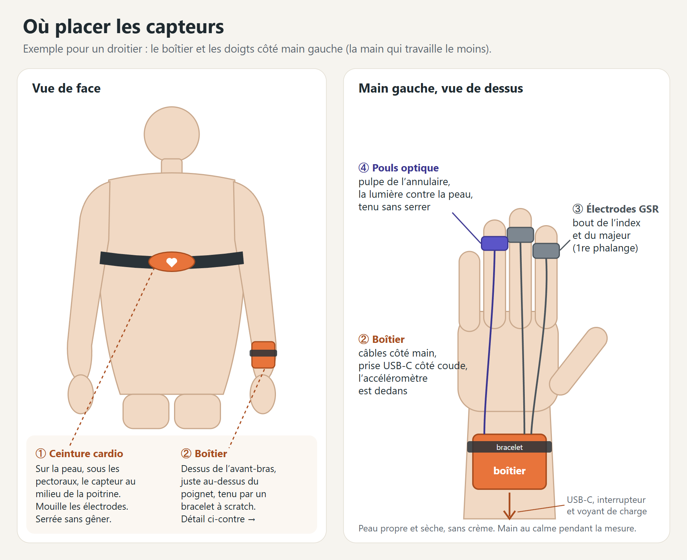
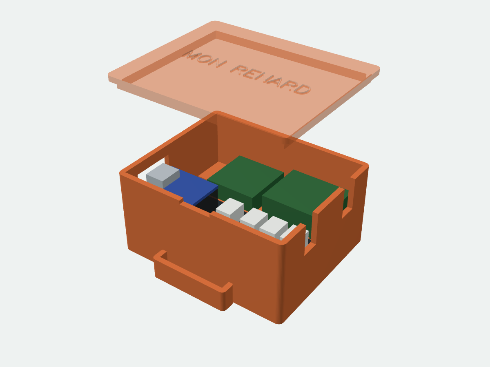

# Matériel : capteurs portés

Deux objets discrets : une **ceinture cardio**, invisible sous un tee-shirt, et une **bague connectée**.
Prix relevés le 15 novembre 2026. **Commandés le 15 novembre 2026.**

## Liste d'achat

| Pièce | Où | Prix |
|---|---|---|
| Ceinture cardio Coospo H6 (envoie les intervalles entre battements) | [Amazon](https://www.amazon.fr/dp/B07JPD924Y) | 26,99 € (+ port possible sous 45 €) |
| Bague connectée Colmi R03, noire, taille 11 (pouls, oxygène du sang, pas, sommeil) | [AliExpress, boutique officielle Colmi](https://fr.aliexpress.com/item/1005007243540237.html) | 28,99 €, port offert |

**Total : environ 56 €.** La R03 est la cousine de la R02 (même appli QRing, même protocole, étanche IP68).
Mi-novembre 2026, la R02 n'existait plus en noir en taille 11 : seulement en doré.

- **La ceinture** donne la variabilité cardiaque précise, battement par battement : la mesure la plus utile pour l'humeur.
  Elle utilise le service Bluetooth standard du pouls, déjà lu par l'appli (`src/sensors/ble/heartRate.ts`).
- **La bague** mesure en continu, jour et nuit, sans rien qui dépasse. Son protocole Bluetooth n'est pas chiffré et a été
  décodé par des passionnés ([colmi_r02_client](https://github.com/tahnok/colmi_r02_client),
  [Gadgetbridge](https://gadgetbridge.org/gadgets/rings/yawell/)) : l'appli pourra la lire sans passer par l'appli du
  fabricant. Modèles Colmi compatibles : R02, R03, R06, R09, R10, R12, à condition qu'ils s'utilisent avec l'appli
  **QRing** : des copies vendues sous le même nom ont un autre matériel et ne sont pas compatibles.

### Trouver la taille de la bague

La bague se porte de préférence à **l'index** de la main qui travaille le moins.

1. Entourer la base de l'index avec une bande de papier, le soir (les doigts gonflent un peu dans la journée).
2. Marquer au stylo l'endroit où la bande se rejoint, puis mesurer la longueur à plat avec une règle, en millimètres.
3. Lire la taille ci-dessous. **Entre deux tailles, prendre la plus grande** : la bague est épaisse à l'intérieur.

| Taille Colmi (R02 et R03) | 8 | 9 | 10 | 11 | 12 |
|---|---|---|---|---|---|
| Diamètre intérieur | 18,1 mm | 18,9 mm | 19,8 mm | 20,3 à 20,6 mm | 21,3 mm |
| Tour de doigt | 57 mm | 59 mm | 62 mm | 64 à 65 mm | 67 mm |

Avec une bague qui va déjà bien à l'index, on peut aussi mesurer son diamètre intérieur. Les retours sont gratuits
pendant 90 jours sur AliExpress si la taille ne va pas.

## Où porter les capteurs

1. **Ceinture cardio** : sur la peau, juste sous les pectoraux, le capteur au milieu de la poitrine.
   Mouiller les deux électrodes avant de la mettre. Pile CR2032 : environ 300 heures.
2. **Bague** : à l'index, capteurs côté paume, ni trop serrée ni trop lâche (elle ne doit pas tourner toute seule).
   Autonomie annoncée : plusieurs jours, avec un boîtier de recharge fourni.

## Ce qui n'est pas mesuré : la conductance de la peau

La conductance de la peau (GSR, ou activité électrodermale) suit la transpiration invisible des doigts, que commande
le système nerveux « d'alerte ». Elle monte quand on est tendu, ému ou excité, en bien comme en mal. Elle mesure donc
l'**intensité** d'une émotion, pas son sens. Aucune bague bon marché ne la mesure : elle pourra revenir plus tard, en
accessoire à porter seulement pour des moments au calme.

## Ancienne piste : le boîtier fait maison (non commandé)

Un boîtier au poignet avec une carte ESP32, la conductance de la peau aux doigts, un pouls optique et un accéléromètre.
Abandonné pour une solution plus discrète, mais gardé ici au cas où.

| Pièce | Où | Prix |
|---|---|---|
| Carte XIAO ESP32-C6, connecteurs soudés | [Gotronic](https://www.gotronic.fr/art-carte-xiao-esp32c6-soude-47621.htm) | 8,90 € |
| Shield Grove pour XIAO (charge la batterie) | [Gotronic](https://www.gotronic.fr/art-shield-grove-xiao-103020312-32393.htm) | 4,90 € |
| Capteur GSR Grove, électrodes de doigts fournies | [Gotronic](https://www.gotronic.fr/art-module-de-conductivite-de-la-peau-gsr-grove-101020052-21341.htm) | 9,90 € |
| Accéléromètre Grove LIS3DHTR | [Gotronic](https://www.gotronic.fr/art-accelerometre-3-axes-grove-114020121-31763.htm) | 4,20 € |
| Batterie LiPo 3,7 V 1000 mAh (52,5 × 34,5 × 6,2 mm) | [Gotronic](https://www.gotronic.fr/art-accu-lipo-3-7-vcc-1000-mah-pr523450-5813.htm) | 9,90 € |
| *Option* : capteur de pouls optique MAX30102 | [Amazon](https://www.amazon.fr/dp/B07RDJLSHY) | 6,99 € |
| *Option* : 5 câbles Grove vers fils femelles (pour le MAX30102) | [Gotronic](https://www.gotronic.fr/art-5-cables-30-cm-grove-4-contacts-femelles-19069.htm) | 4,20 € |

### Le boîtier à imprimer en 3D (`boitier/`)

| Fichier | Pièce |
|---|---|
| `boitier-base.stl` | le boîtier, avec les passants du bracelet (66 × 65 × 32 mm) |
| `boitier-plateau.stl` | le plateau posé au-dessus de la batterie, qui porte la carte et les capteurs |
| `boitier-couvercle.stl` | le couvercle, qui s'emboîte |
| `boitier-couvercle-grave.stl` | le même couvercle avec « MON RENARD » gravé (le logiciel d'impression devra peut-être réparer de petites jonctions) |

**Impression** : PETG, couches de 0,2 mm, 3 périmètres, remplissage 20 %, **sans supports**. Les fichiers sont déjà orientés.

**Montage**
1. Souder les deux fils de la batterie sur les pastilles BAT du shield (fil rouge sur +, noir sur −).
2. Enficher la carte XIAO sur le shield.
3. Brancher le capteur GSR sur la prise A0, l'accéléromètre sur une prise I2C. Option : le MAX30102 sur
   l'autre prise I2C avec un câble à fils femelles (rouge → VIN, noir → GND, blanc → SDA, jaune → SCL).
4. Poser la batterie au fond du boîtier, entre les butées, et faire passer ses fils par l'encoche du plateau.
5. Poser le plateau. Coller le shield avec de l'adhésif mousse, poussé contre la butée : la prise USB-C,
   l'interrupteur et le voyant de charge arrivent dans la fente. Coller le capteur GSR et l'accéléromètre
   sur la bande libre, à côté.
6. Faire sortir les câbles des doigts par les deux encoches du côté opposé à la prise USB, puis emboîter
   le couvercle (l'encoche sur le côté sert à le soulever avec un ongle).

La hauteur des connecteurs de la carte n'étant pas publiée, le boîtier garde de la marge. Pour modifier le dessin :
`npm install @jscad/modeling@2.12.5 @jscad/stl-serializer@2.1.20` dans un dossier de travail, puis
`node boitier.mjs <dossier de sortie>`.
